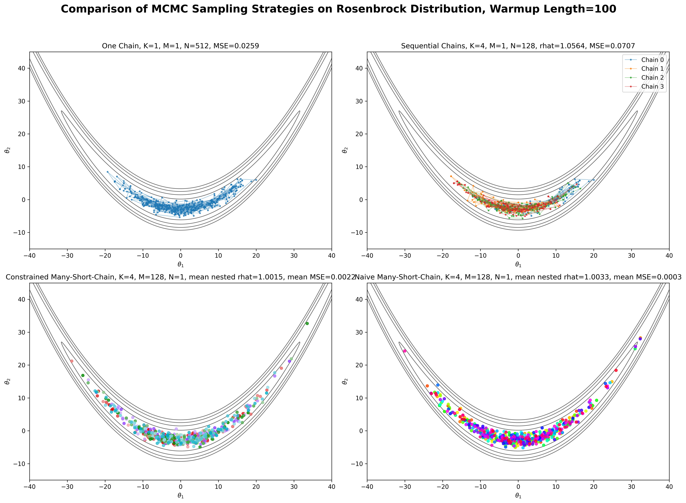

# Why Many Short Chains?

[Introduce MCMC and briefly explain its role in sampling from complex probability distributions.]

## Warmup and Sampling

[Explain the two phases.]

[Insert warmup/sampling diagram.]

## Why Multiple Chains?

[Explain the traditional use of multiple chains and introduce the intuition behind (\widehat{R}): comparing within-chain and between-chain variation can help identify when chains have not mixed consistently. 
Then extend this idea to modern parallel hardware: running multiple chains concurrently creates an opportunity to scale MCMC sampling, motivating the investigation of many short chains.]

## Comparing Chain Configurations

As mentioned above, MCMC sampling can be organized in different ways, from a single long chain to multiple conventional chains or many short chains that can potentially exploit parallel computation.
However, changing the chain configuration also changes how sampling behavior and estimation accuracy should be assessed.

The following experiment compares four sampling strategies on the Rosenbrock distribution. 
Each uses 100 warmup iterations, and the sampling runs are controlled to achieve the same effective sample size (ESS=512). 
The panels show the sampling trajectories alongside the diagnostic appropriate to each method and the mean squared error (MSE), allowing us to compare both diagnostic behavior and estimation accuracy.

Matching warmup length and ESS provides a controlled basis for comparing the methods, but it does not necessarily equalize their computational costs. 
Runtime and energy consumption may differ depending on the smapling strategy and hw effectively it exploits the parallel hardware. 
These are additional considerations when evaluating the practical efficiency of different methods.

This comparison motivates the central question of this project: **when sampling is distributed across many short chains, do the associated convergence diagnostics provide a reliable picture of estimation quality?**
and motivates our investigation of Nested $\widehat{R}$.

