# Reproducing Existing Work

## The Starting Point

[Explain the existing many-short-chain work.]

## Nested $\widehat{R}$
### Some terms...
Denoting $\theta^{(nmk)}$ as the n-th draw from chain m of superchain k, and $f^{nmk}=f(\theta^{(nmk)})$ 

The sample mean of k-th superchain is:  

$\bar f^{(\cdot\cdot k)} = \frac{1}{MN}\sum^{M}_{m=1} \sum^{N}_{n=1}f^{nmk}$ 

Final estimator is obtained by averaging all the superchains:  
$\bar f^{(\cdot\cdot\cdot)} = \frac{1}{K}\sum^{K}_{k=1}\bar f^{(\cdot\cdot k)}$ 

### Estimator of between-superchain variance
$\widehat{B_{\nu}} = \frac{1}{K-1}\sum^{K}_{k=1}(\bar f^{(\cdot\cdot k)}-\bar f^{(\cdot\cdot\cdot)})^{2}$ 

### Estimator of within-superchain variance
$\widehat{W_{\nu}} =\frac{1}{K}\sum^{K}_{k=1}(\tilde{B_k}+\tilde{W_k})$, where $\tilde{B_k}$ is the estimator for between-chain variance 
^[I personally prefer calling it between-subchain variance since this is computed for subchains in every superchain] 
and $\tilde{W_k}$ is the estimator for within-chain variance
^[Again, prefer calling it within-subchain variance for the same reason] 

$$
\tilde{B_k} \triangleq \begin{cases} 
      \frac{1}{M-1}\sum^{M}_{m=1}(\bar f^{\cdot mk} - \bar f^{\cdot \cdot k})^2, & \text{if} M > 1 \\\\ 
      0, & \text{if} M = 1 
   \end{cases}
$$

$$
\tilde{W_k} \triangleq \begin{cases} 
      \frac{1}{M}\sum^{M}_{m=1}\frac{1}{N-1}\sum^{N}_{n=1}(f^{nmk} - \bar f^{\cdot mk})^2, & \text{if} N > 1 \\\\ 
      0, & \text{if} N = 1 
   \end{cases}
$$

Then, our $\widehat{R}_{\nu}$ is:

$$
\widehat{R}_{\nu} \triangleq \sqrt{\frac{\widehat{W_{\nu}} + \widehat{B_{\nu}}}{\widehat{W_{\nu}}}} = \sqrt{1+\frac{\widehat{B_{\nu}}}{\widehat{W_{\nu}}}}
$$

## The $N=1$ Case

The paper chose to conduct numerical experiments with setting $N=1$ ^[since it is "many-short-chain"].
From a mathematical point of view, when we only take one after-warmup sample from the sampler, the nested r-hat would have some interesting properties, where the $\tilde{W_k}$ goes to 0, and it simplifies to:

$$
\widehat{R}_{\nu} = 
\sqrt{1+\frac{\frac{1}{K-1}\sum^{K}_{k=1}(\bar f^{(\cdot\cdot k)}-\bar f^{(\cdot\cdot\cdot)})^{2}}{\frac{1}{K}\sum^K_{k=1}\frac{1}{M-1}\sum^M_{m=1}(\bar f^{(1mk)}-\bar f^{(\cdot \cdot k)})^2}}
$$
it looks terrifying, but I promise this will help us later, for now we can see that we don't have to worry about adding two estimators in $\widehat{W_{\nu}}$, and it looks like we are doing something to a function of ratio of two estimators of some kind of variance.

## Initialization Strategies

There are two types of initialization strategies we could use when doing many-short-chain: constrained initialization and naive initialization.
Regardless of the initialization techniques, the computation procedure is the same.

### Constrained Initialization

From our starting distribution, we sample $K$ positions, then replicate each position across the $M$ subchains belonging to its superchain. Subchains within the same superchain therefore share an initial position.

### Naive Initialization

We directly sample $K*M$ positions independently from our starting distribution, then assign them to superchains and subchains according to the prescribed grouping. Subchains in the same superchain need not share an initial position.^[Basically, we "pretend" that the first K positions belong to the same superchain, and "pretend" the next K positions belong to another superchain...and so on. ]

## Reproducing the Results

### Scaled Squared Error vs. Warmup Length

::: {layout-nrow=2}
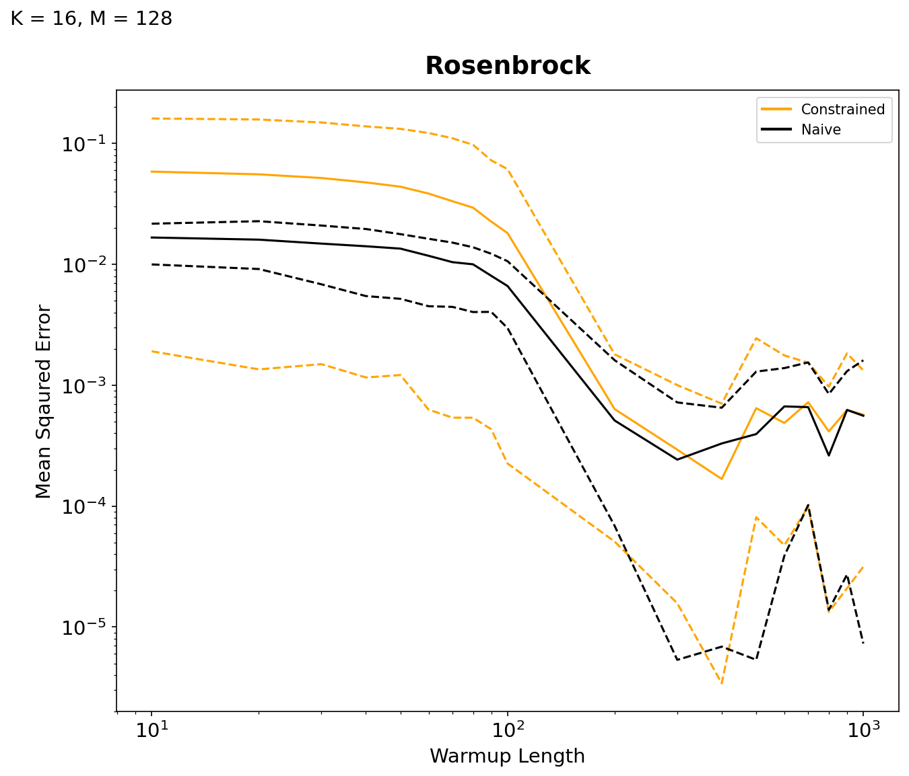

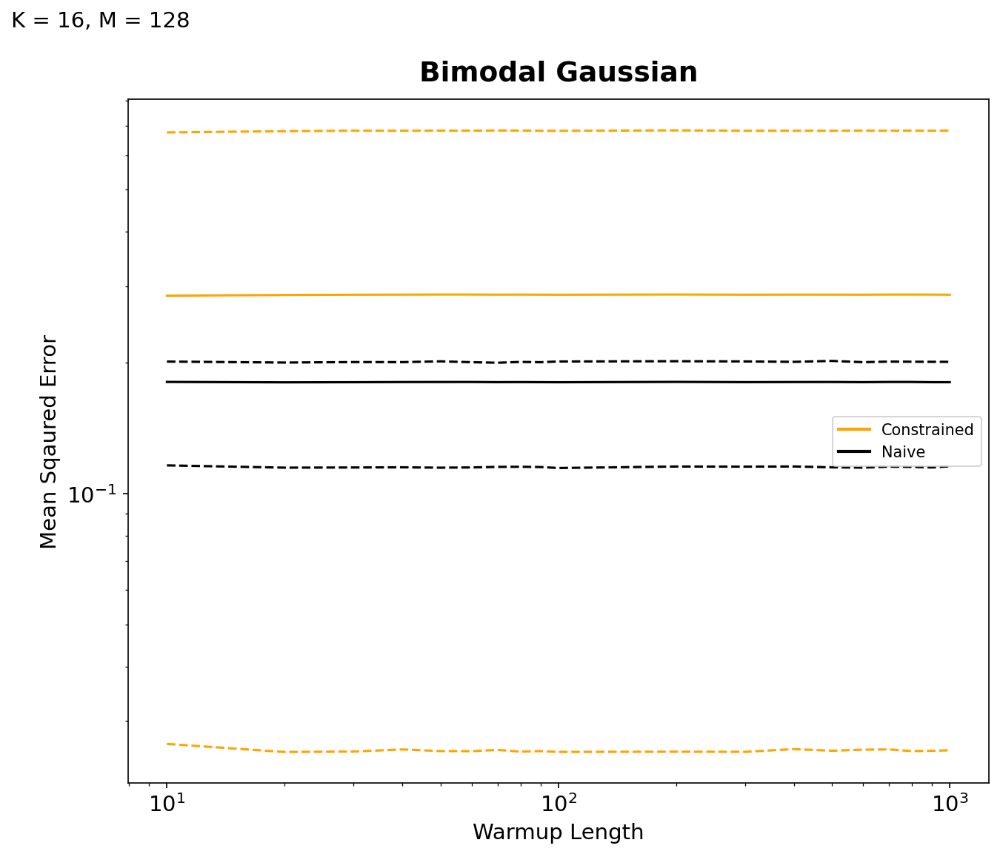

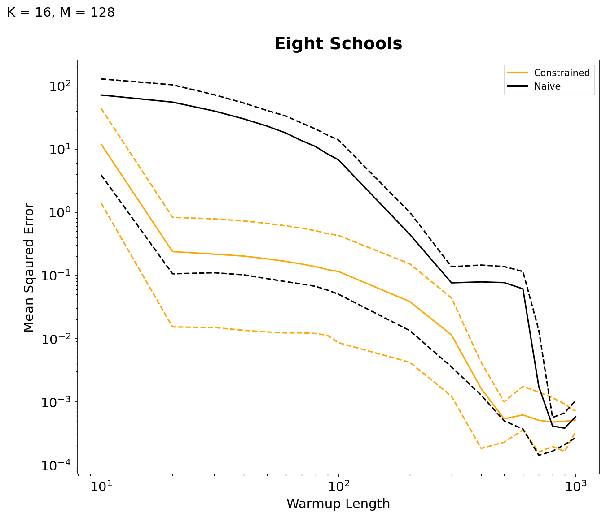

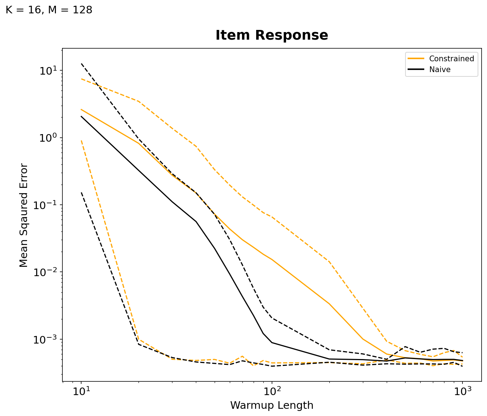
:::

### Scaled Squared Error vs. Nested $\widehat{R}$, under Constrained intialization
::: {layout-nrow=2}
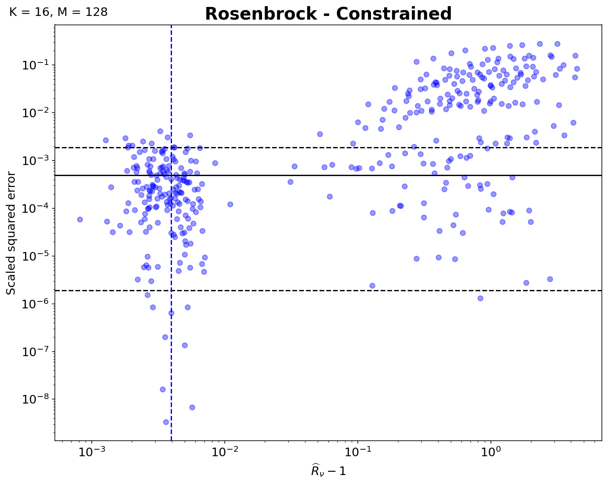

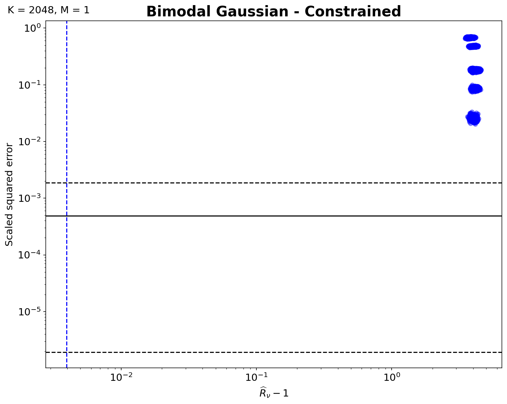

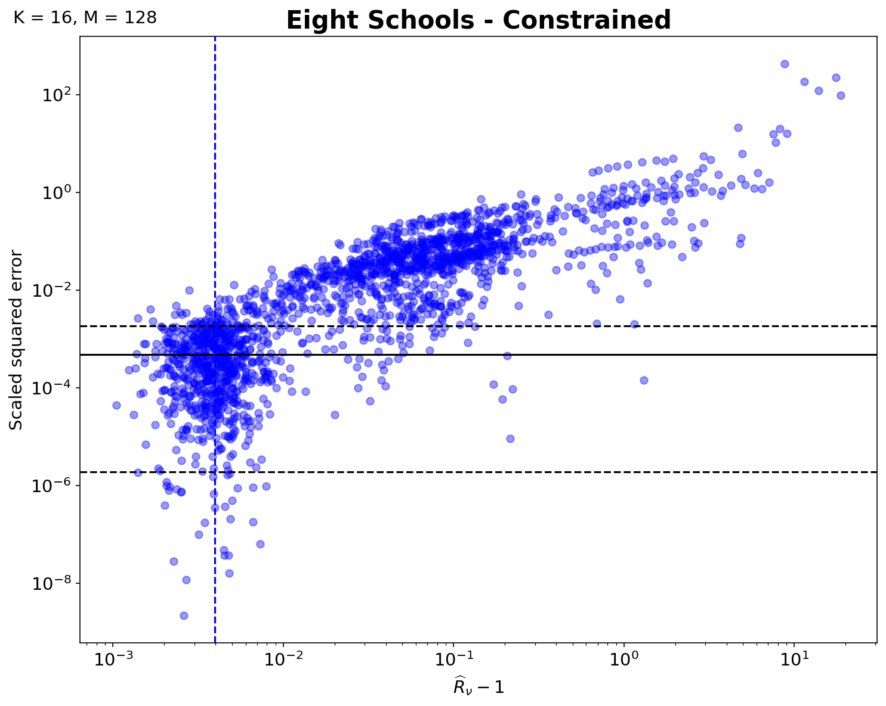

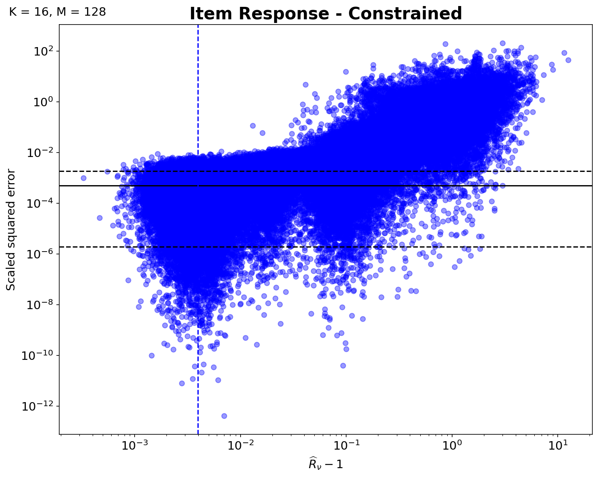
:::

### Scaled Squared Error vs. Nested $\widehat{R}$, under Naive intialization
::: {layout-nrow=2}
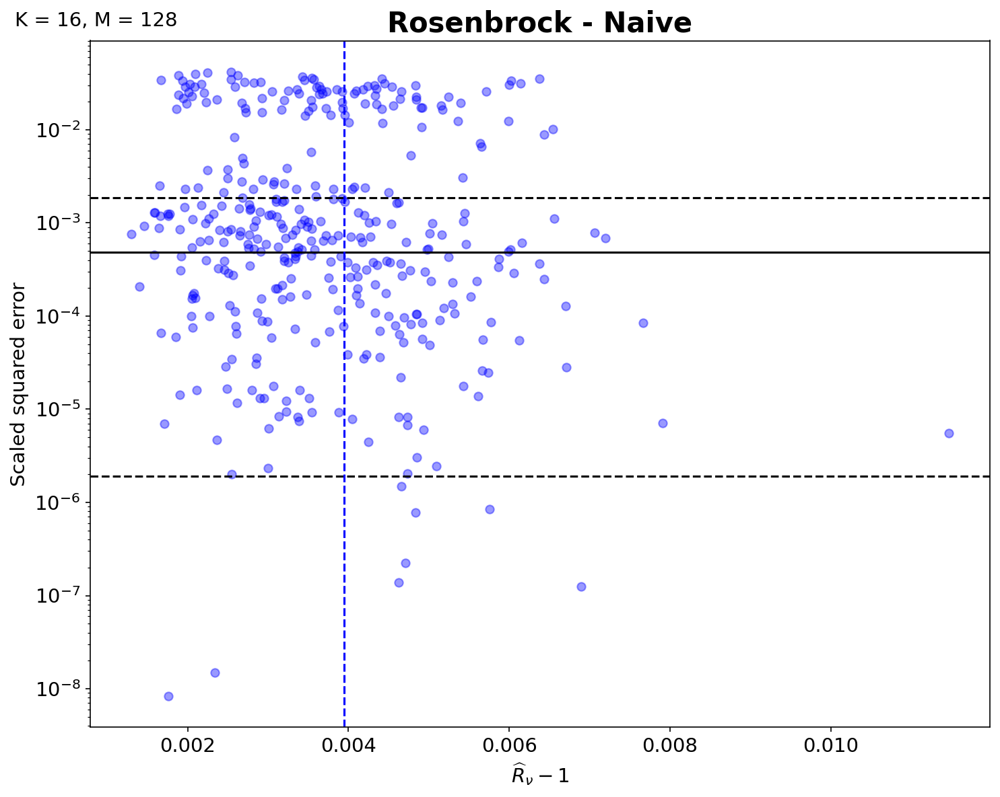

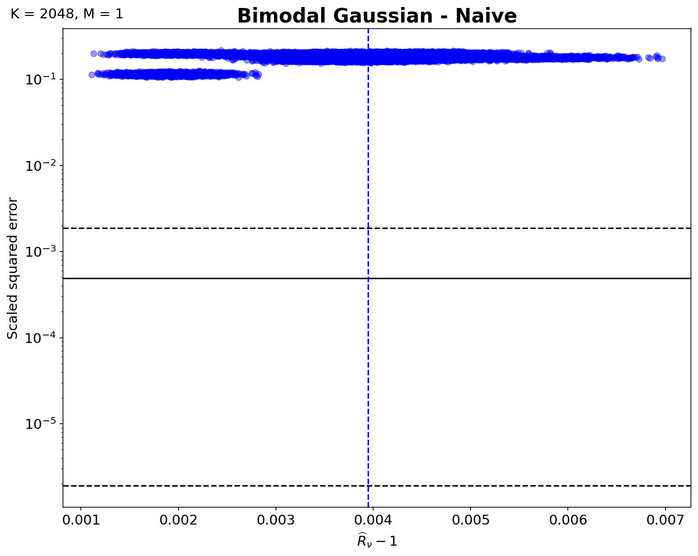

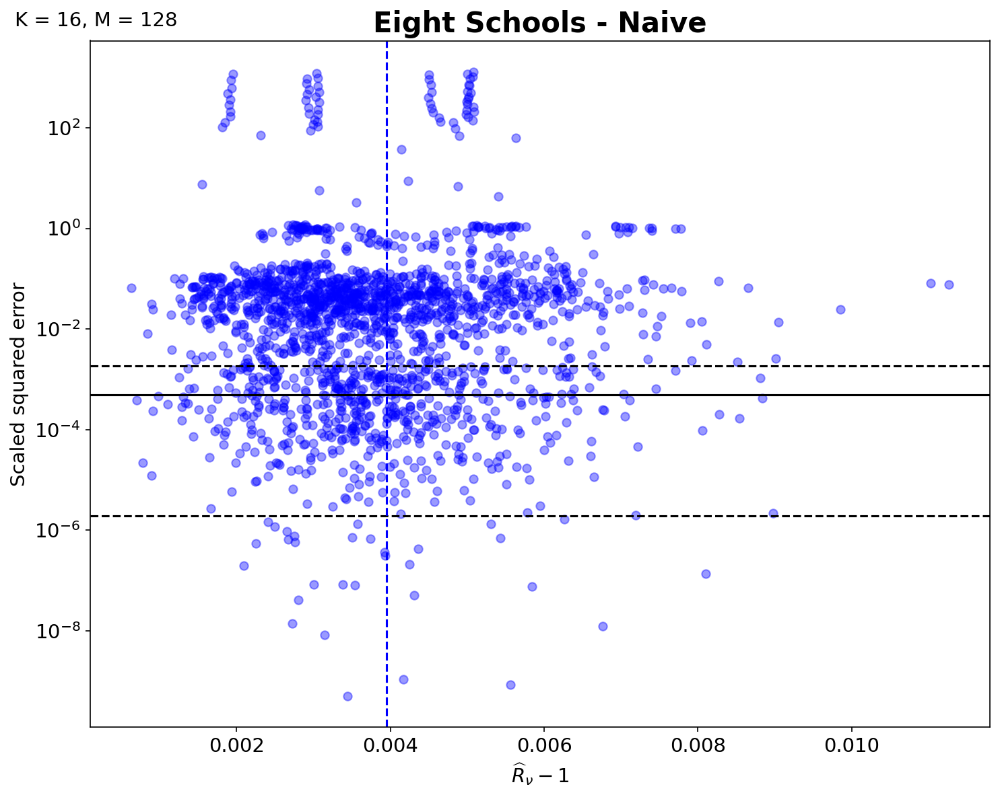

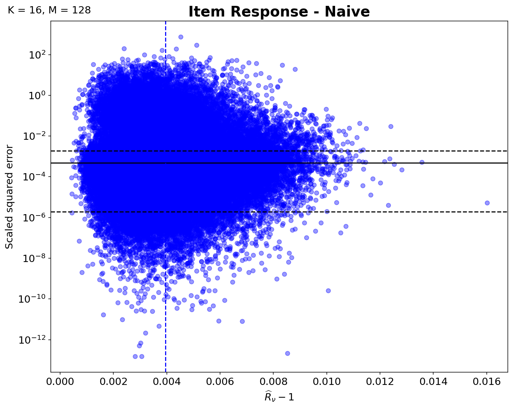
:::

## What Did We Learn?

[Short interpretation.]

## The Next Question

> Is the observed behavior specific to the computational framework?