# Is the Computational Framework Responsible?

## Why Change Frameworks?

[Explain the motivation.]

## Moving to BlackJAX

[Briefly explain the transition.]

## Repeating the Experiments

## Comparing Frameworks

::: {layout-nrow=2}
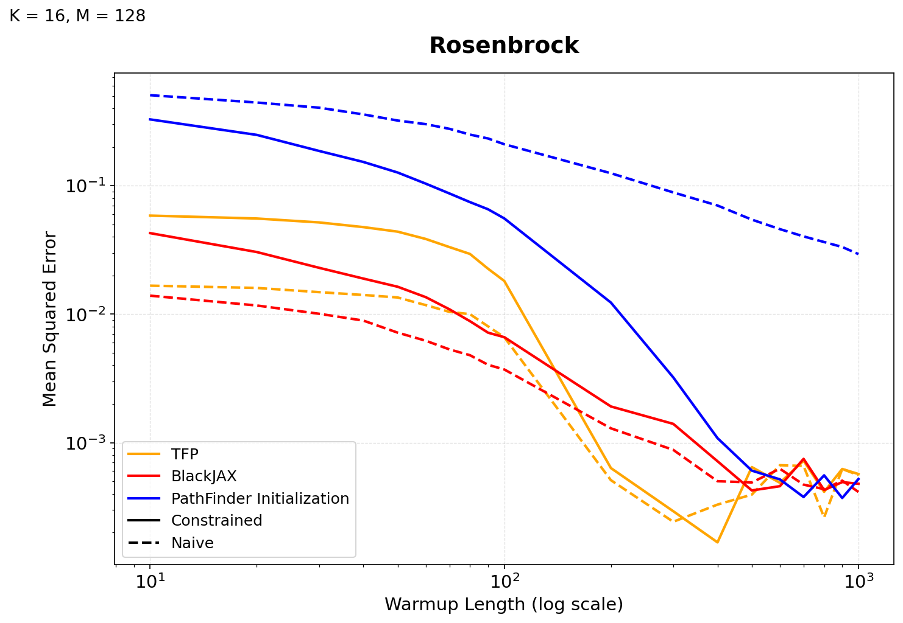

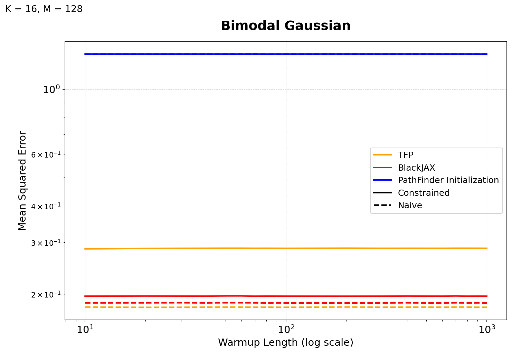

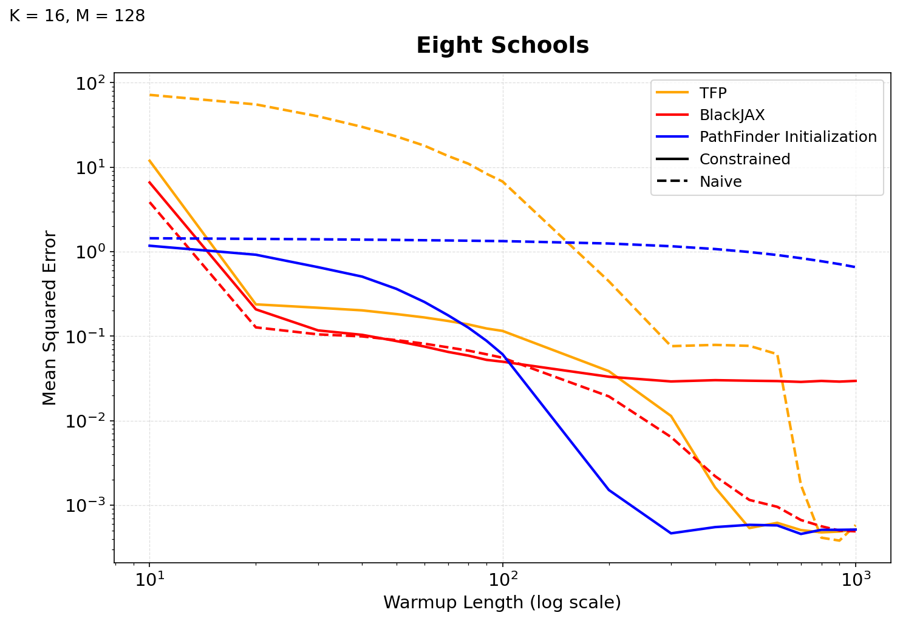

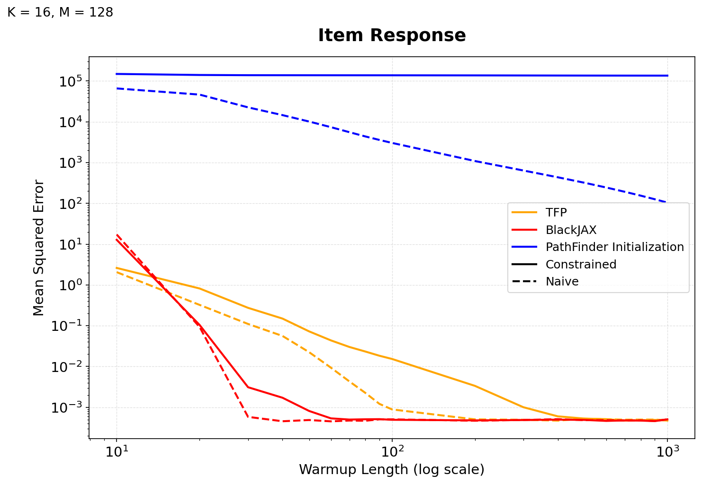
:::

### Warmup-Coloring

::: {layout-nrow=4}
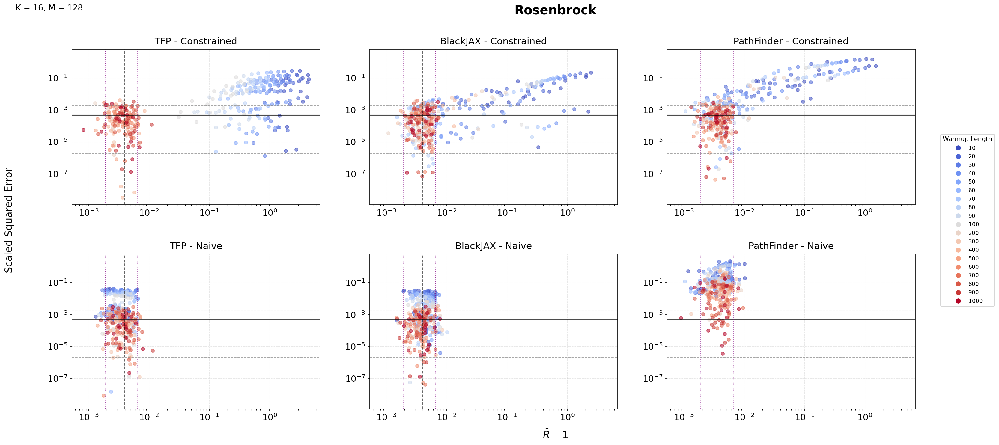

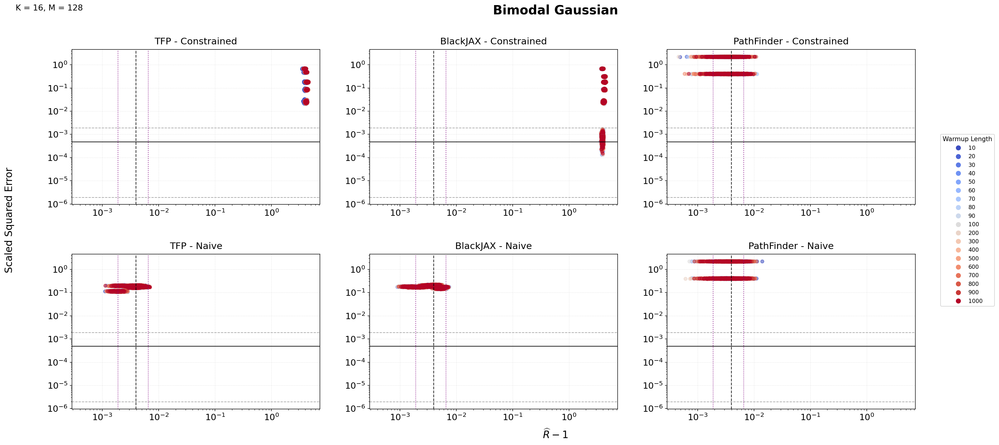

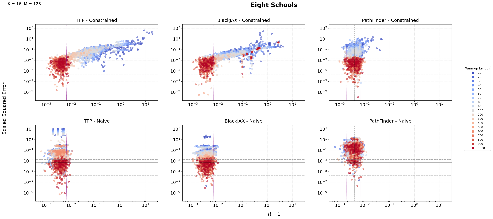

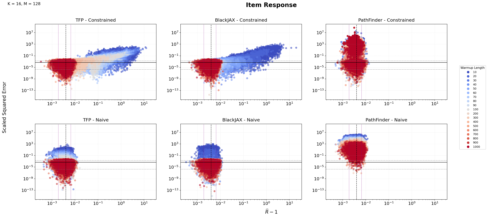
:::
BlackJAX implementation returned good performance that is compatible to the original TFP implementation. And PathFinder, for some models, performed well.
What's really interesting is PathFinder's performance on IRT distribution, where for all other distributions, 
PathFinder with constrained initialization has shown some "improvements" in scaled squared error as warmup length increases, but it is not the case for IRT.

Taking a closer look:

::: {layout-nrow=3}
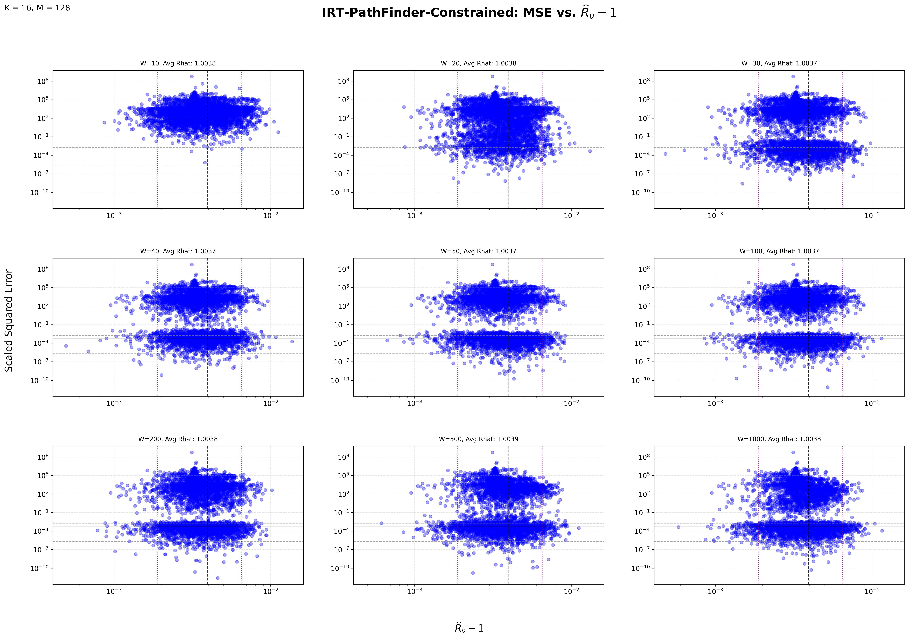

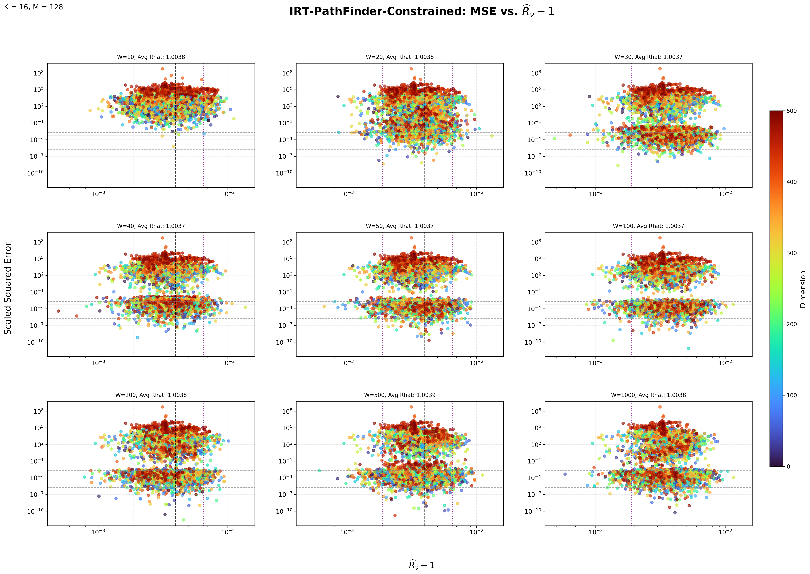

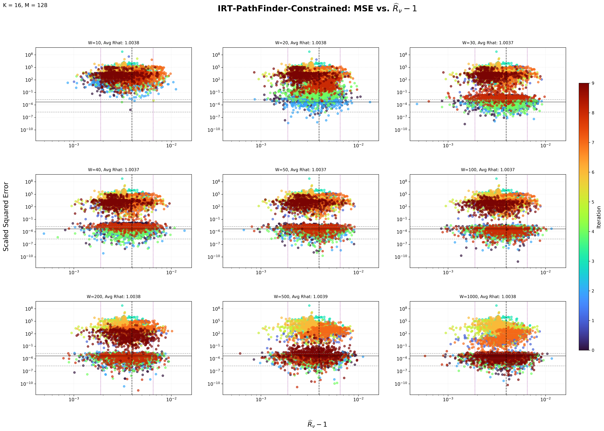

:::
## Interpretation

Dimension-wise, there are no clear evidence that certain dimension are hard to explore during the warmup.
But the scatter plot colored by iteration showed that from certain iteration, the error started off high where the nested Rhat seems to be centered around the desired threshold. 
Not only that, the error remained high even after a long warmup period where $W=1000$.

## The Next Question

> If initialization matters, what exactly is initialization doing?