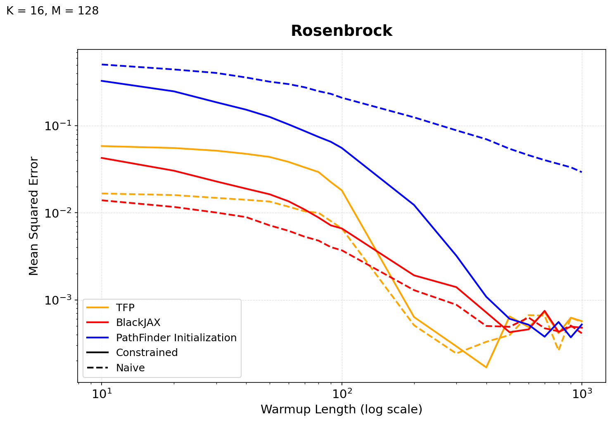
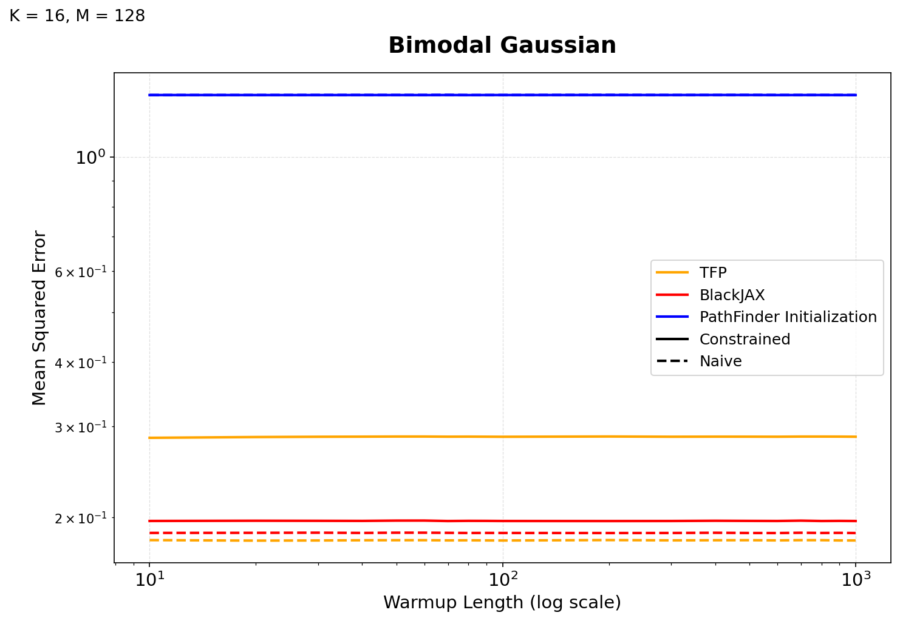
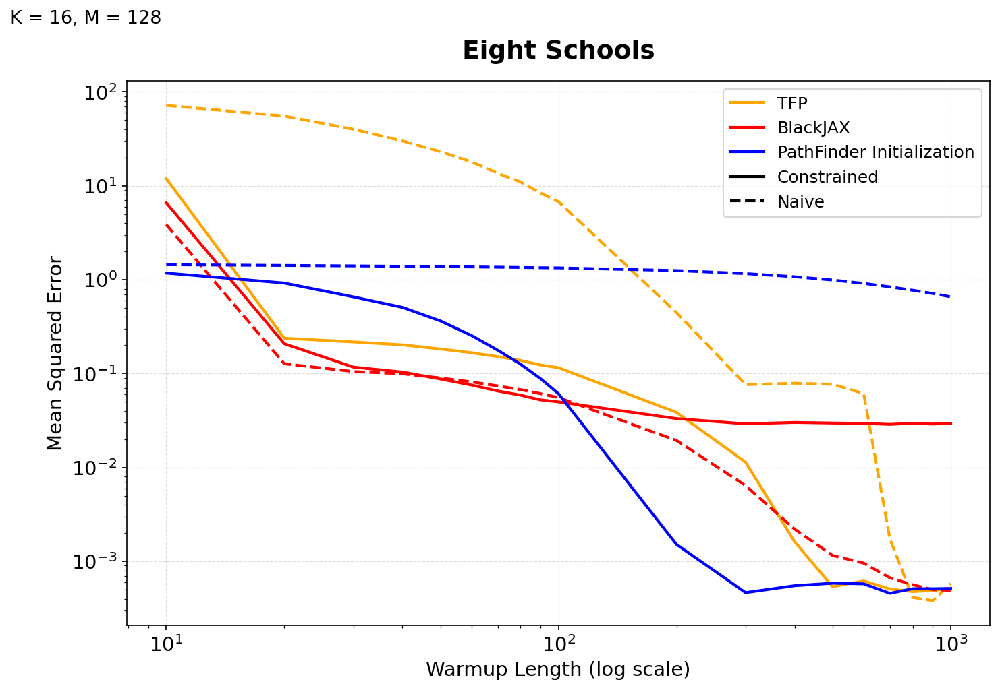
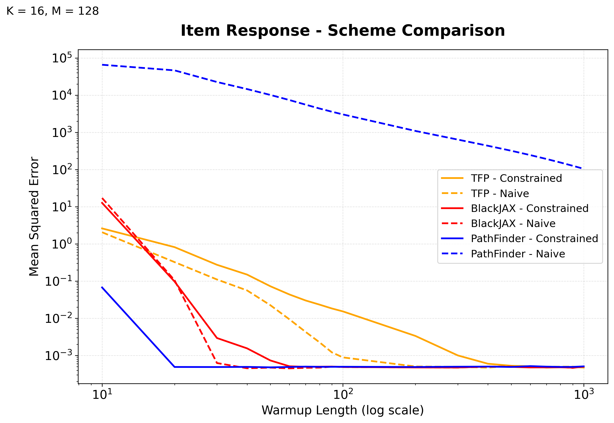
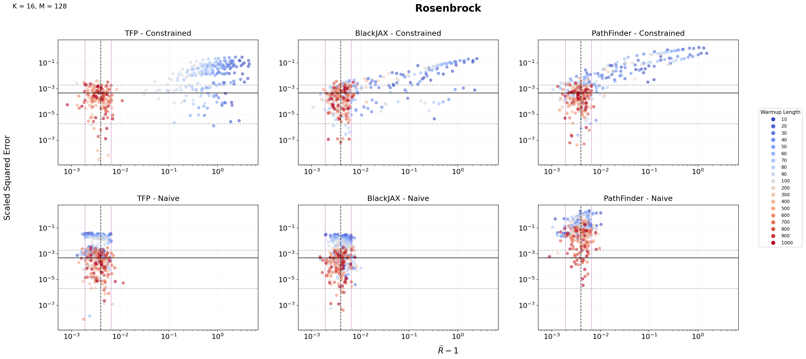
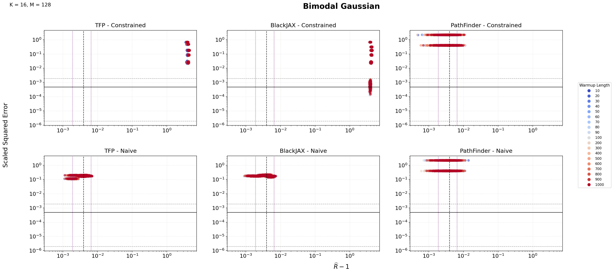
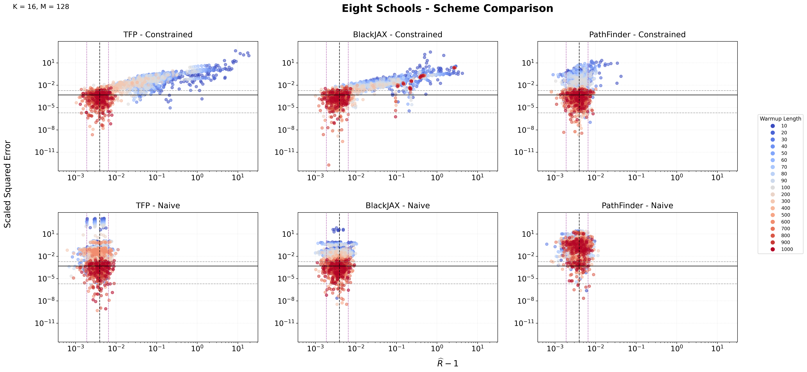
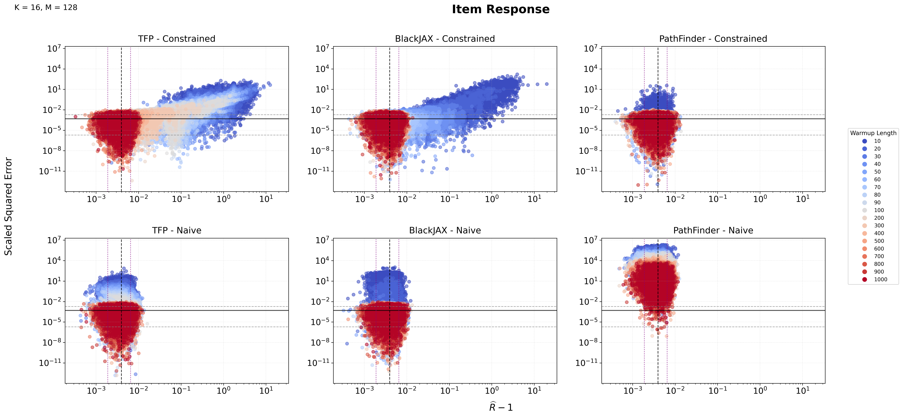

# Is the Computational Framework Responsible?

## Why Change Frameworks?

[Explain the motivation.]

## Moving to BlackJAX

[Briefly explain the transition.]

## Repeating the Experiments

## Comparing Frameworks

::: {layout-nrow=2}

:::

### Warmup-Coloring

::: {layout-nrow=4}

:::
BlackJAX implementation returned good performance that is compatible to the original TFP implementation. And PathFinder, for some models, performed well. What is really interesting is that even with 
the constrained scheme, Pathfinder method returns results similar to the naive initialization, where the transition in Scaled Squared Error is not accompanied with transition in $$\widehat{R}_{\nu}$$.
Furthermore, the naive initialization from Pathfinder method returned results where even after a long warmup, the samples remained high scaled squared error.

## The Next Question

> If initialization matters, what exactly is initialization doing?