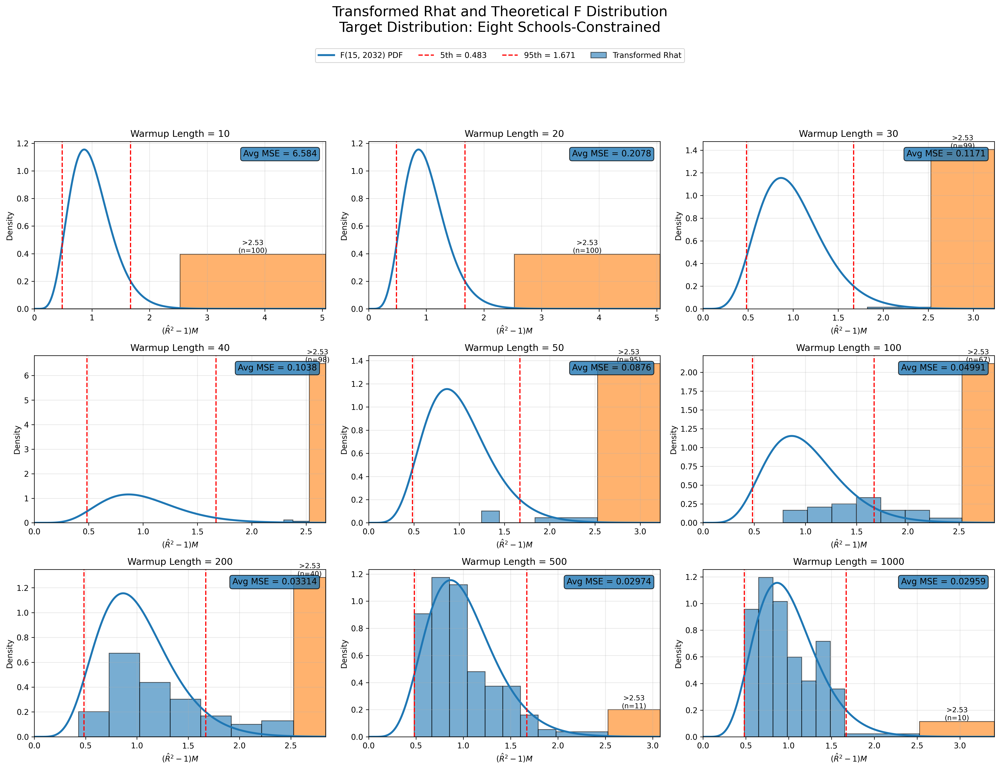
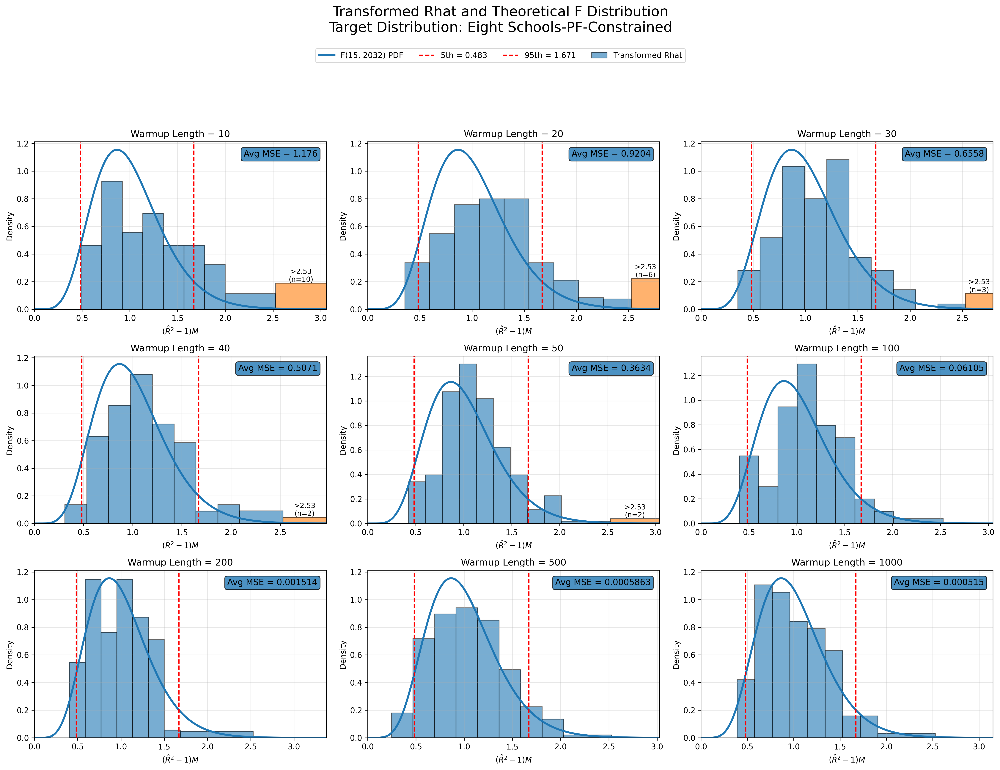
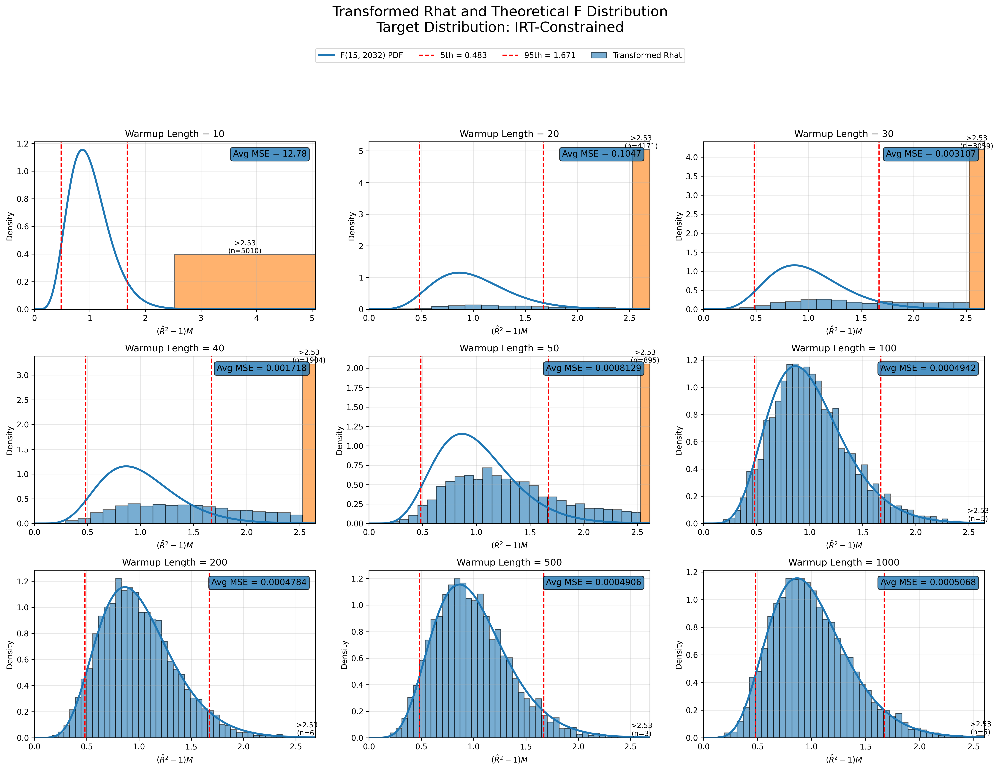
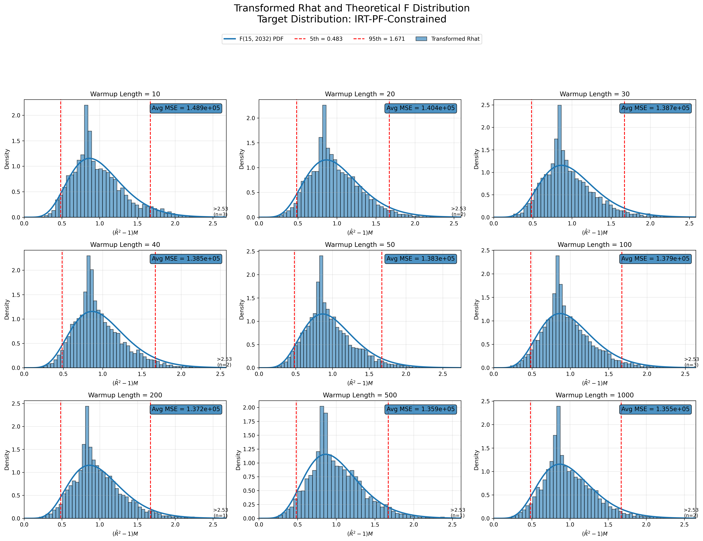
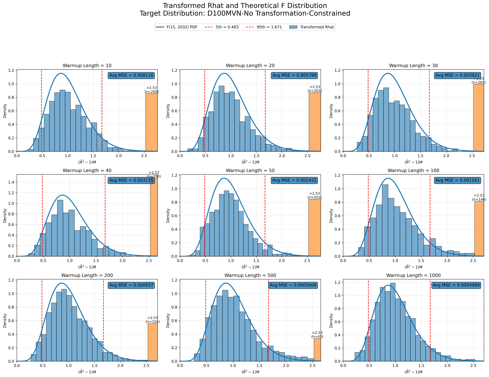
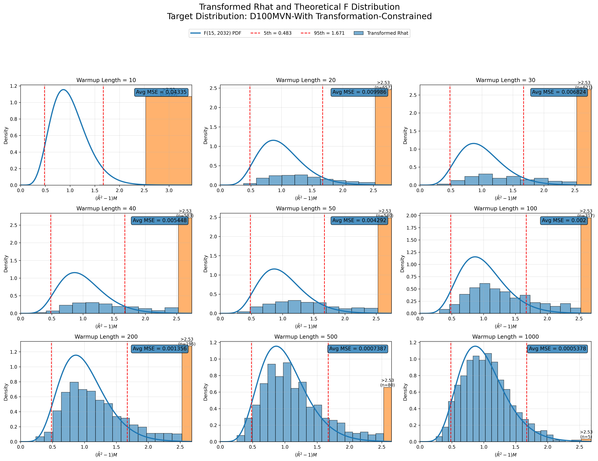
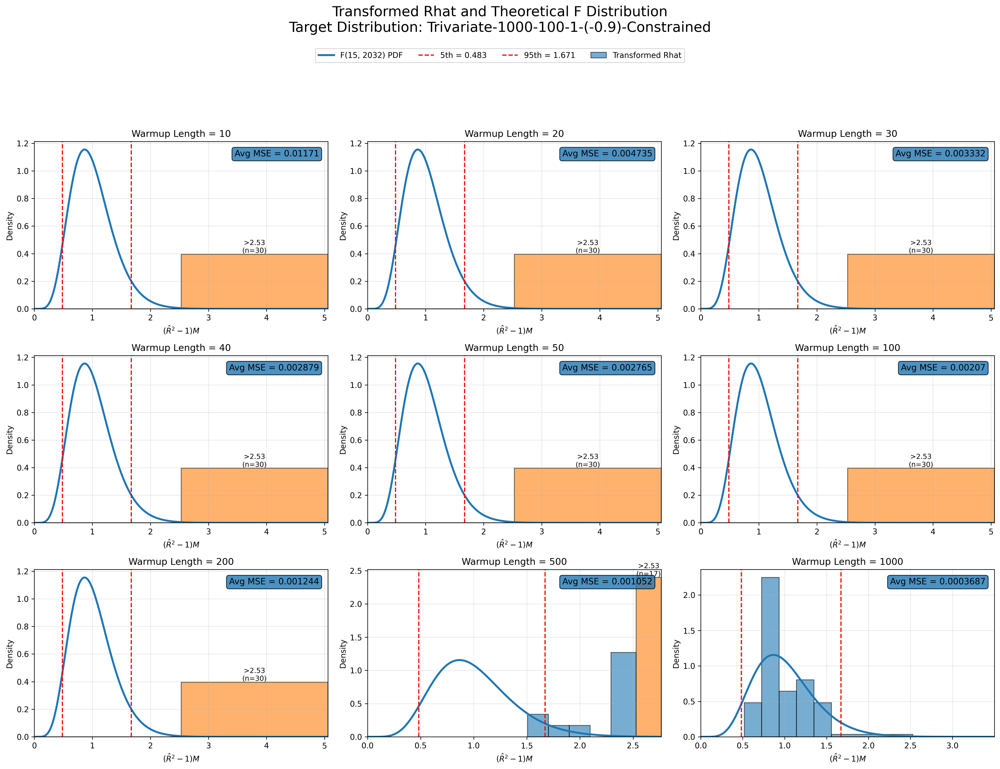
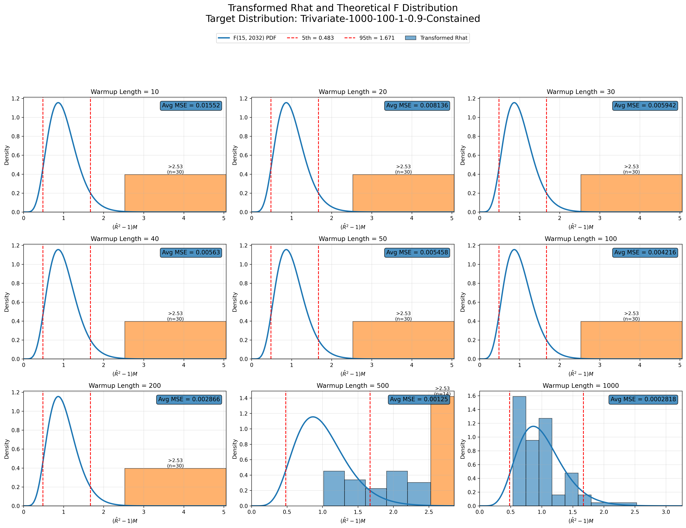

# What Do We Know?

## Distribution of diagnostics

Before doing anything. Perhaps you are courious about the two verical lines in the scaled squared error vs $\widehat{R_{\nu}}$

And moment of truth: those are values derived from 5th and 95th quantile of an F distribution.

Recall our $\widehat{R}_{\nu}$ is:

$$
\widehat{R}_{\nu} \triangleq \sqrt{\frac{\widehat{W_{\nu}} + \widehat{B_{\nu}}}{\widehat{W_{\nu}}}} = \sqrt{1+\frac{\widehat{B_{\nu}}}{\widehat{W_{\nu}}}}
$$

where under the case of $N=1$, which is our case:

$$
\widehat{R}_{\nu} = 
\sqrt{1+\frac{\frac{1}{K-1}\sum^{K}_{k=1}(\bar f^{(\cdot\cdot k)}-\bar f^{(\cdot\cdot\cdot)})^{2}}{\frac{1}{K}\sum^K_{k=1}\frac{1}{M-1}\sum^M_{m=1}(\bar f^{(1mk)}-\bar f^{(\cdot \cdot k)})^2}}
$$

Few interesting things happen if we assume we are sampling a multivariate normal distribution, and we have reached stationarity.
From each chain we only take one after-warmup sample, therefore we have KM samples which are mutually independent from each other:

$f^{(1mk)}_d \sim i.i.d N(\mu_d, \sigma^2_d)$ 

for d being arbitrary dimension in the target distribution.

From Central Limit Theorem, we have 

$\bar f^{(1 \cdot k)}_d \sim i.i.d N(\mu_d, \frac{\sigma^2_d}{M}), \bar f^{(\cdot \cdot \cdot)}_d \sim N(\mu_d, \frac{\sigma^2_d}{MK})$

$\widehat{W_{\nu}} =\frac{1}{K}\sum^{K}_{k=1}(\tilde{B_k}+\tilde{W_k}) = \frac{1}{K}\sum^{K}_{k=1}\tilde{B_k}$

$\widehat{W_{\nu}}_d = \frac{1}{K}\sum^{K}_{k=1}\tilde{B_k}_d$

$\tilde{B_k}_d = \frac{1}{M-1}\sum^{M}_{m=1}(f^{1mk}_d - \bar f^{1\cdot k}_d)^2$ $\implies$ $\frac{(M-1)\tilde{B_k}_d}{\sigma^2_d} \sim X^2_{M-1}$

$\widehat{W_{\nu}}_d = \frac{1}{K}\sum^{K}_{k=1}\tilde{B_k}_d \implies \frac{(M-1)K\widehat{W_{\nu}}_d}{\sigma^2_d} \sim X^2_{K(M-1)}$ 

$\widehat{B_{\nu}}_d = \frac{1}{K-1}\sum^{K}_{k=1}(\bar f^{(1\cdot k)}-\bar f^{(1\cdot\cdot)})^{2} \implies \frac{M(K-1)\widehat{B_{\nu}}}{\sigma^2_d} \sim X^2_{K-1}$

$$
\frac{\frac{M(K-1)\widehat{B_{\nu}}_d}{\sigma^2_d}/(K-1)}{\frac{(M-1)K\widehat{W_{\nu}}_d}{\sigma^2_d}/(M-1)K} = M\frac{\widehat{B_{\nu}}_d}{\widehat{W_{\nu}}_d} \sim F_{(K-1), (M-1)K}
$$

And our $\widehat{R_{\nu}}_d =\sqrt{1+\frac{\widehat{B_{\nu}}_d} {\widehat{W_{\nu}}_d}}$, which means it is a function of a random variable following F distribution!

This is under the assumption that our target distribution is multivariate normal, but what about other distributions? We plot the following histograms to visualize emperical distribution of nested rhat, or more precisely, the between-superchain and within-superchain variance ratio.

## Plots

### Histograms

#### Eight Schools distribution
::: {layout-nrow=2}

:::

#### Item Response distribution
::: {layout-nrow=2}

:::

#### D100 normal distribution
::: {layout-nrow=2}

:::

#### Trivariate distribution
::: {layout-nrow=2}

:::

## An Open Question

[Explain what you don't yet understand.]

## Moving Toward Controlled Experiments

[Why MVNs are the next step.]