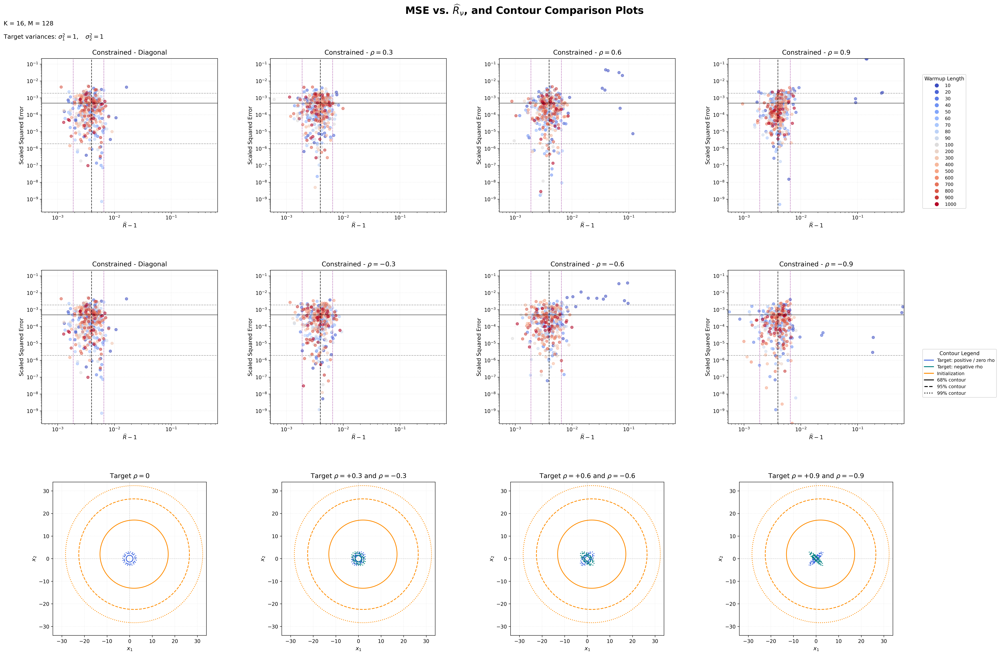
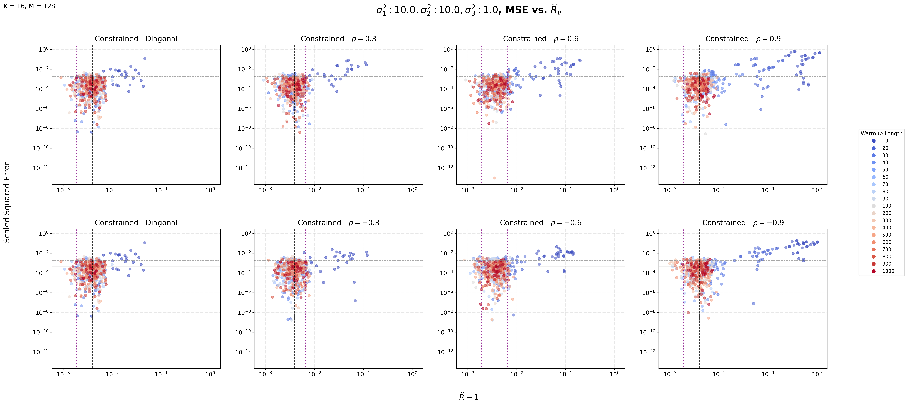
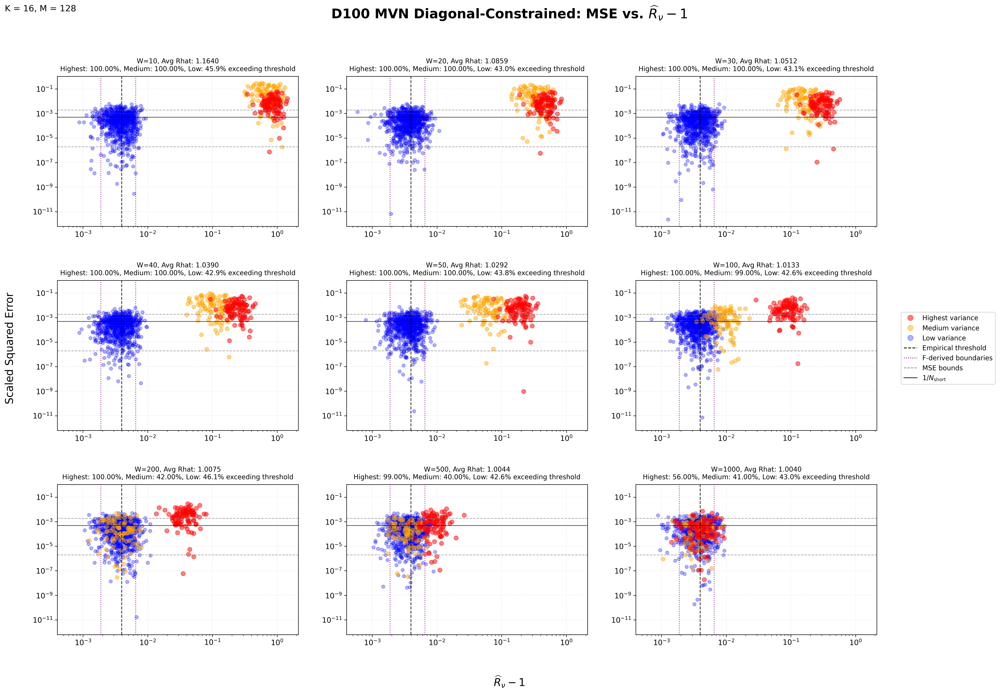

## **Why Multivariate Normal Distributions?**

[Explain why controlled distributions are useful.]

## **The Experimental Strategy**

We systematically vary:

- dimensionality,
- variance structure,
- correlation structure,
- anisotropy,
- coordinate representation.

The main quantities of interest are:

- warmup length,
- nested $\widehat{R}$,
- mean squared error.

## **1. Bivariate Normal Distributions**

### Varying Covariance Structures

Choose a variance configuration to compare its MSE–$\widehat{R}_{\nu}$ relationship with the corresponding Gaussian contours.

```{=html}


<div class="covariance-explorer">

  <div class="covariance-selector" role="group" aria-label="Choose target marginal variances">
    <button class="cov-btn" type="button" data-config="1-1" aria-pressed="true">
      <span class="cov-pair">σ<sub>1</sub><sup>2</sup> = 1, σ<sub>2</sub><sup>2</sup> = 1</span>
      <span class="cov-caption">Equal variances</span>
    </button>
    <button class="cov-btn" type="button" data-config="10-1" aria-pressed="false">
      <span class="cov-pair">σ<sub>1</sub><sup>2</sup> = 10, σ<sub>2</sub><sup>2</sup> = 1</span>
      <span class="cov-caption">Mild anisotropy</span>
    </button>
    <button class="cov-btn" type="button" data-config="100-1" aria-pressed="false">
      <span class="cov-pair">σ<sub>1</sub><sup>2</sup> = 100, σ<sub>2</sub><sup>2</sup> = 1</span>
      <span class="cov-caption">Strong anisotropy</span>
    </button>
    <button class="cov-btn" type="button" data-config="1000-1" aria-pressed="false">
      <span class="cov-pair">σ<sub>1</sub><sup>2</sup> = 1000, σ<sub>2</sub><sup>2</sup> = 1</span>
      <span class="cov-caption">Extreme anisotropy</span>
    </button>
    <button class="cov-btn" type="button" data-config="10-10" aria-pressed="false">
      <span class="cov-pair">σ<sub>1</sub><sup>2</sup> = 10, σ<sub>2</sub><sup>2</sup> = 10</span>
      <span class="cov-caption">Equal variances</span>
    </button>
    <button class="cov-btn" type="button" data-config="100-10" aria-pressed="false">
      <span class="cov-pair">σ<sub>1</sub><sup>2</sup> = 100, σ<sub>2</sub><sup>2</sup> = 10</span>
      <span class="cov-caption">Anisotropic</span>
    </button>
    <button class="cov-btn" type="button" data-config="1000-10" aria-pressed="false">
      <span class="cov-pair">σ<sub>1</sub><sup>2</sup> = 1000, σ<sub>2</sub><sup>2</sup> = 10</span>
      <span class="cov-caption">Strong anisotropy</span>
    </button>
    <button class="cov-btn" type="button" data-config="100-100" aria-pressed="false">
      <span class="cov-pair">σ<sub>1</sub><sup>2</sup> = 100, σ<sub>2</sub><sup>2</sup> = 100</span>
      <span class="cov-caption">Equal variances</span>
    </button>
    <button class="cov-btn" type="button" data-config="1000-100" aria-pressed="false">
      <span class="cov-pair">σ<sub>1</sub><sup>2</sup> = 1000, σ<sub>2</sub><sup>2</sup> = 100</span>
      <span class="cov-caption">Anisotropic</span>
    </button>
    <button class="cov-btn" type="button" data-config="1000-1000" aria-pressed="false">
      <span class="cov-pair">σ<sub>1</sub><sup>2</sup> = 1000, σ<sub>2</sub><sup>2</sup> = 1000</span>
      <span class="cov-caption">Equal variances</span>
    </button>
  </div>

  <div class="covariance-display">
    <div class="covariance-display-header">
      <h4 id="covariance-title">Target variances: 1 and 1</h4>
      <span class="covariance-status" id="covariance-status" aria-live="polite">Configuration 1 of 10</span>
    </div>
    <div class="covariance-image-wrap">
      
    </div>
  </div>

  <p class="covariance-help">
    Each figure combines the MSE versus nested R-hat scatterplots for the correlation settings with the corresponding target and initialization-distribution contours.
  </p>
</div>
```


<!-- -->

### Varying Target Distribution Rotation

*Use this tool to visualize how the target distribution rotates.*

The following visualization shows the 68% and 95% probability regions of two bivariate normal distributions. 
We hypothesize that the ratio between the overlap volume of target-proposal distribution 
over the total volume of proposal distribution might contribute to how nested $\widehat{R}$ behaves across warmups.

<div id="bvn-experiment"></div>

<script>
  bvnVisualizer("bvn-experiment");
</script>


## **2. Trivariate Normal**

### Varying Covariance Structures


<div class="button-row">
  <button class="tri-btn" data-config="10-10-1">$\sigma_1^2 = 10,\ \sigma_2^2 = 10,\ \sigma_3^2 = 1$</button>
  <button class="tri-btn" data-config="100-10-1">$\sigma_1^2 = 100,\ \sigma_2^2 = 10,\ \sigma_3^2 = 1$</button>
  <button class="tri-btn" data-config="100-100-1">$\sigma_1^2 = 100,\ \sigma_2^2 = 100,\ \sigma_3^2 = 1$</button>
  <button class="tri-btn" data-config="1000-100-1">$\sigma_1^2 = 1000,\ \sigma_2^2 = 100,\ \sigma_3^2 = 1$</button>
</div>

<div class="plot-panel">
  
</div>


### Varying Initialization Distribution

[Add explanation or visualization.]

## **3. 100-Dimensional MVN**

[Explanation]

### Highlight Plots


<div class="button-row">
  <button class="d100-btn" data-image="noTransform">Diagonal</button>
  <button class="d100-btn" data-image="withTransform">Transformed</button>
</div>

<div class="plot-panel">
  
</div>


## **What Are We Looking For?**

We are looking for the connection between MSE and $\widehat{R}_{\nu}$ across different distributions.


<script>
function setupImageSwitcher(buttonSelector, onSelect) {
  const buttons = document.querySelectorAll(buttonSelector);

  buttons.forEach(btn => {
    btn.addEventListener('click', () => {
      onSelect(btn);

      buttons.forEach(b => {
        b.classList.remove('active');
        if (b.hasAttribute('aria-pressed')) {
          b.setAttribute('aria-pressed', 'false');
        }
      });
      btn.classList.add('active');
      if (btn.hasAttribute('aria-pressed')) {
        btn.setAttribute('aria-pressed', 'true');
      }
    });
  });

  // Mark the first button active on initial page load.
  if (buttons.length > 0) {
    buttons[0].classList.add('active');
  }
}

// 1. Bivariate covariance plots (combined MSE-Rhat and contour figure)
setupImageSwitcher('.cov-btn', btn => {
  const [var1, var2] = btn.dataset.config.split('-');
  const base =
    '../figures/chapter05/covariance_structure/bivariate/';

  const plot = document.getElementById('cov-plot');
  plot.src = `${base}${var1}_${var2}.png`;
  plot.alt =
    `MSE versus nested R-hat scatterplots and Gaussian contours for target variances ${var1} and ${var2}`;

  document.getElementById('covariance-title').textContent =
    `Target variances: ${var1} and ${var2}`;

  const buttons = Array.from(document.querySelectorAll('.cov-btn'));
  const index = buttons.indexOf(btn);
  document.getElementById('covariance-status').textContent =
    `Configuration ${index + 1} of ${buttons.length}`;
});

// 2. Trivariate covariance plots
setupImageSwitcher('.tri-btn', btn => {
  const filename = btn.dataset.config.replace(/-/g, '_');
  const base =
    '../figures/chapter05/covariance_structure/trivariate/';

  document.getElementById('tri-plot').src =
    `${base}${filename}.png`;
});

// 3. 100-dimensional MVN highlight plots
setupImageSwitcher('.d100-btn', btn => {
  const base =
    '../figures/chapter05/covariance_structure/d100/';

  const filename = btn.dataset.image === 'noTransform'
    ? 'highlight_noTransform.png'
    : 'highlight_withTransform.png';

  document.getElementById('d100-plot').src =
    base + filename;
});
</script>
