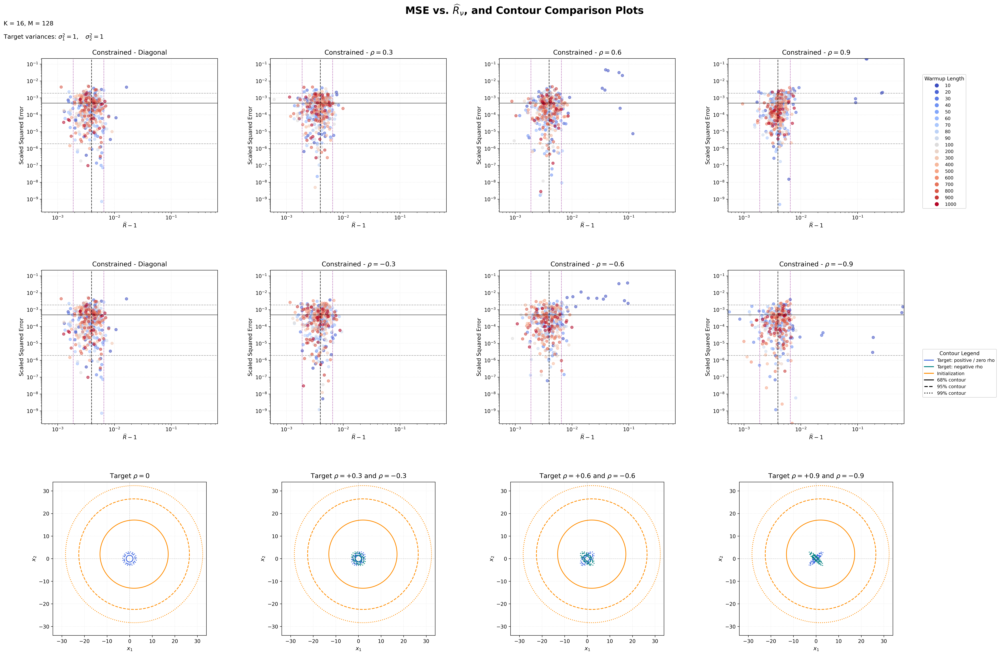
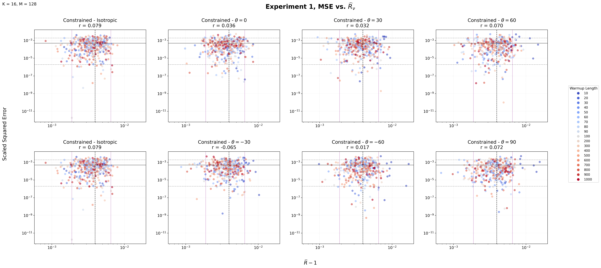
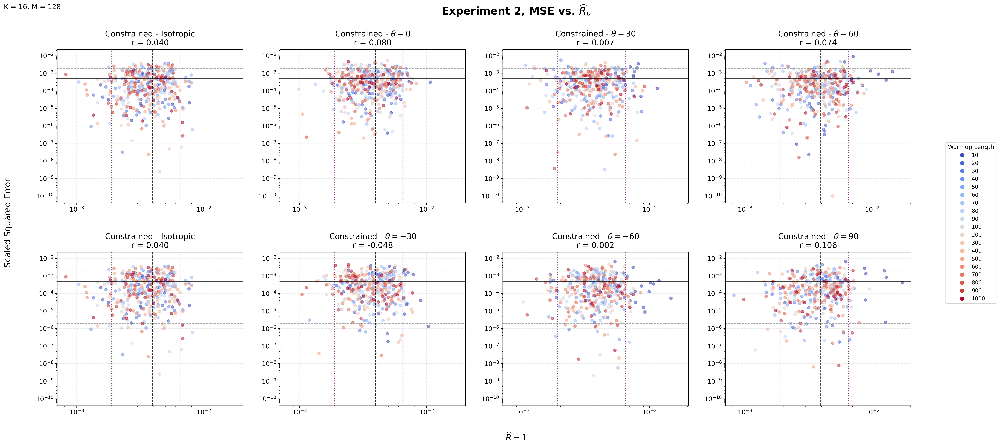
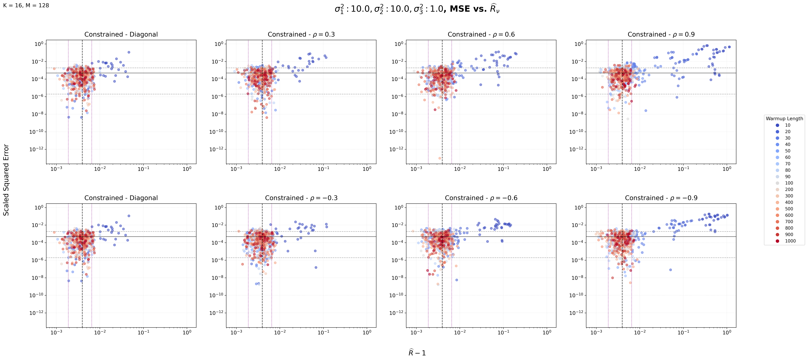
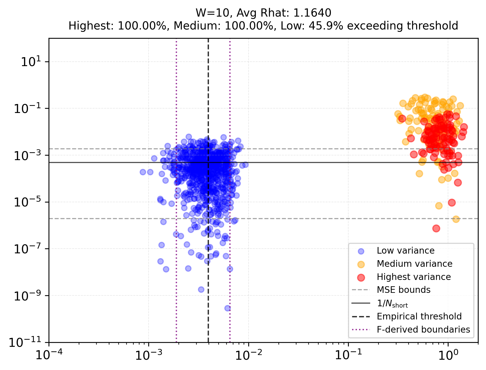

## **Why Multivariate Normal Distributions?**

[Explain why controlled distributions are useful.]

## **The Experimental Strategy**

We systematically vary:

- dimensionality,
- variance structure,
- correlation structure,
- anisotropy,
- coordinate representation.

The main quantities of interest are:

- warmup length,
- nested $\widehat{R}$,
- mean squared error.

## **1. Bivariate Normal Distributions**

### Varying Covariance Structures

Choose a variance configuration to compare its MSE–$\widehat{R}_{\nu}$ relationship with the corresponding Gaussian contours.

```{=html}
<div class="covariance-explorer">

  <div class="covariance-selector" role="group" aria-label="Choose target marginal variances">
    <button class="cov-btn" type="button" data-config="1-1" aria-pressed="true">
      <span class="cov-pair">σ<sub>1</sub><sup>2</sup> = 1, σ<sub>2</sub><sup>2</sup> = 1</span>
      <span class="cov-caption">Equal variances</span>
    </button>
    <button class="cov-btn" type="button" data-config="10-1" aria-pressed="false">
      <span class="cov-pair">σ<sub>1</sub><sup>2</sup> = 10, σ<sub>2</sub><sup>2</sup> = 1</span>
      <span class="cov-caption">Mild anisotropy</span>
    </button>
    <button class="cov-btn" type="button" data-config="100-1" aria-pressed="false">
      <span class="cov-pair">σ<sub>1</sub><sup>2</sup> = 100, σ<sub>2</sub><sup>2</sup> = 1</span>
      <span class="cov-caption">Strong anisotropy</span>
    </button>
    <button class="cov-btn" type="button" data-config="1000-1" aria-pressed="false">
      <span class="cov-pair">σ<sub>1</sub><sup>2</sup> = 1000, σ<sub>2</sub><sup>2</sup> = 1</span>
      <span class="cov-caption">Extreme anisotropy</span>
    </button>
    <button class="cov-btn" type="button" data-config="10-10" aria-pressed="false">
      <span class="cov-pair">σ<sub>1</sub><sup>2</sup> = 10, σ<sub>2</sub><sup>2</sup> = 10</span>
      <span class="cov-caption">Equal variances</span>
    </button>
    <button class="cov-btn" type="button" data-config="100-10" aria-pressed="false">
      <span class="cov-pair">σ<sub>1</sub><sup>2</sup> = 100, σ<sub>2</sub><sup>2</sup> = 10</span>
      <span class="cov-caption">Anisotropic</span>
    </button>
    <button class="cov-btn" type="button" data-config="1000-10" aria-pressed="false">
      <span class="cov-pair">σ<sub>1</sub><sup>2</sup> = 1000, σ<sub>2</sub><sup>2</sup> = 10</span>
      <span class="cov-caption">Strong anisotropy</span>
    </button>
    <button class="cov-btn" type="button" data-config="100-100" aria-pressed="false">
      <span class="cov-pair">σ<sub>1</sub><sup>2</sup> = 100, σ<sub>2</sub><sup>2</sup> = 100</span>
      <span class="cov-caption">Equal variances</span>
    </button>
    <button class="cov-btn" type="button" data-config="1000-100" aria-pressed="false">
      <span class="cov-pair">σ<sub>1</sub><sup>2</sup> = 1000, σ<sub>2</sub><sup>2</sup> = 100</span>
      <span class="cov-caption">Anisotropic</span>
    </button>
    <button class="cov-btn" type="button" data-config="1000-1000" aria-pressed="false">
      <span class="cov-pair">σ<sub>1</sub><sup>2</sup> = 1000, σ<sub>2</sub><sup>2</sup> = 1000</span>
      <span class="cov-caption">Equal variances</span>
    </button>
  </div>

  <div class="covariance-display">
    <div class="covariance-display-header">
      <h4 id="covariance-title">Target variances: 1 and 1</h4>
      <span class="covariance-status" id="covariance-status" aria-live="polite">Configuration 1 of 10</span>
    </div>
    <div class="covariance-image-wrap">
      
    </div>
  </div>

  <p class="covariance-help">
    Each figure combines the MSE versus nested R-hat scatterplots for the correlation settings with the corresponding target and initialization-distribution contours.
  </p>
</div>
```


<!-- -->

### Varying Target Distribution Rotation

*Use this tool to visualize how the target distribution rotates.*

The following visualization shows the 68% and 95% probability regions of two bivariate normal distributions. 
We hypothesize that the ratio between the overlap volume of target-proposal distribution 
over the total volume of proposal distribution might contribute to how nested $\widehat{R}$ behaves across warmups.

<div id="bvn-experiment"></div>

<script>
  bvnVisualizer("bvn-experiment");
</script>

### Experiment on the ratio of covariance matrix eigen values

This experiment investigates how the ratio of covariance eigenvalues and relative positioning of the target and proposal distributions affect MCMC sampling performance. 
By replacing an isotropic target with diagonal targets whose eigenvalues are \((25,64)\) or \((20,80)\), 
we introduce different degrees of anisotropy while preserving the determinant—and therefore the contour area—of the original isotropic target. 
Each configuration is tested under two positional treatments: concentric and shifted relative to the proposal. 
We then repeat the same set of treatments after halving the isotropic target's variance and the corresponding diagonal eigenvalues, allowing us to examine whether the effects of target geometry and positioning persist at a smaller overall scale. 
These comparisons help isolate how anisotropy, target–proposal alignment, and target scale influence sampling performance.

First group:

|  Eigen Ratio / Mean | Concentric ($\underline{\mu} = [2, 2]$) | Shifted  ($\underline{\mu} = [4.1, 1.3]$) |
|:-------------|:-----------------|:-----------------|
| **Rate 1(0.4)**   | Experiment 1     | Experiment 2     |
| **Rate 2(0.25)**   | Experiment 3     | Experiment 4     |

Second group:

| Eigen Ratio / Mean | Concentric ($\underline{\mu} = [2, 2]$)| Shifted ($\underline{\mu} = [4.1, 1.3]$)|
|:-------------|:-----------------|:-----------------|
| **Rate 1 (0.4)**   | Experiment 5     | Experiment 6     |
| **Rate 2 (0.25)**   | Experiment 7     | Experiment 8     |


```{=html}
<div id="experiment-selector" class="experiment-selector">

  <div class="experiment-select">
    <label for="experiment-1"><strong>First experiment:</strong></label>
    <select id="experiment-1">
      <option value="1">Experiment 1</option>
      <option value="2">Experiment 2</option>
      <option value="3">Experiment 3</option>
      <option value="4">Experiment 4</option>
      <option value="5">Experiment 5</option>
      <option value="6">Experiment 6</option>
      <option value="7">Experiment 7</option>
      <option value="8">Experiment 8</option>
    </select>
  </div>

  <div class="experiment-select">
    <label for="experiment-2"><strong>Second experiment:</strong></label>
    <select id="experiment-2">
      <option value="1">Experiment 1</option>
      <option value="2" selected>Experiment 2</option>
      <option value="3">Experiment 3</option>
      <option value="4">Experiment 4</option>
      <option value="5">Experiment 5</option>
      <option value="6">Experiment 6</option>
      <option value="7">Experiment 7</option>
      <option value="8">Experiment 8</option>
    </select>
  </div>

</div>

<div id="experiment-plots">

  <div class="experiment-plot">
    <h4 id="plot-title-1">Experiment 1</h4>
    
  </div>

  <div class="experiment-plot">
    <h4 id="plot-title-2">Experiment 2</h4>
    
  </div>

</div>

<script>

document.addEventListener("DOMContentLoaded", function () {

  const select1 = document.getElementById("experiment-1");
  const select2 = document.getElementById("experiment-2");

  const plot1 = document.getElementById("plot-1");
  const plot2 = document.getElementById("plot-2");

  const title1 = document.getElementById("plot-title-1");
  const title2 = document.getElementById("plot-title-2");

  const figurePath =
    "../figures/chapter05/covariance_structure/bivariate/";

  function updatePlots() {

    const exp1 = select1.value;
    const exp2 = select2.value;

    // Update image sources
    plot1.src = figurePath + "experiment_" + exp1 + ".png";
    plot2.src = figurePath + "experiment_" + exp2 + ".png";

    // Update titles
    title1.textContent = "Experiment " + exp1;
    title2.textContent = "Experiment " + exp2;

    // Update alternative text
    plot1.alt = "Experiment " + exp1 + " plot";
    plot2.alt = "Experiment " + exp2 + " plot";

    // Prevent selecting the same experiment twice
    Array.from(select1.options).forEach(option => {
      option.disabled = option.value === exp2;
    });

    Array.from(select2.options).forEach(option => {
      option.disabled = option.value === exp1;
    });
  }

  // Handle selection changes
  select1.addEventListener("change", updatePlots);
  select2.addEventListener("change", updatePlots);

  // Initialize
  updatePlots();

});

</script>
```

## **2. Trivariate Normal**

### Varying Covariance Structures


<div class="button-row">
  <button class="tri-btn" data-config="10-10-1">$\sigma_1^2 = 10,\ \sigma_2^2 = 10,\ \sigma_3^2 = 1$</button>
  <button class="tri-btn" data-config="100-10-1">$\sigma_1^2 = 100,\ \sigma_2^2 = 10,\ \sigma_3^2 = 1$</button>
  <button class="tri-btn" data-config="100-100-1">$\sigma_1^2 = 100,\ \sigma_2^2 = 100,\ \sigma_3^2 = 1$</button>
  <button class="tri-btn" data-config="1000-100-1">$\sigma_1^2 = 1000,\ \sigma_2^2 = 100,\ \sigma_3^2 = 1$</button>
</div>

<div class="plot-panel">
  
</div>


### Varying Initialization Distribution

[Add explanation or visualization.]

## **3. 100-Dimensional MVN**

[Explanation]

### Highlight Plots
```{=html}
<div id="d100-experiment" class="d100-explorer">

  <div class="d100-controls">
    <div class="d100-control-header">
      <label for="d100-w-slider">Warmup length, W</label>
      <output id="d100-w-value" for="d100-w-slider">10</output>
    </div>

    
  <div class="d100-slider-wrap">
    <input
      id="d100-w-slider"
      type="range"
      min="0"
      max="8"
      step="1"
      value="0"
      aria-label="Select warmup length W"
    />

  <div class="d100-ticks" aria-hidden="true">
    <div class="d100-tick"><span>10</span></div>
    <div class="d100-tick"><span>20</span></div>
    <div class="d100-tick"><span>30</span></div>
    <div class="d100-tick"><span>40</span></div>
    <div class="d100-tick"><span>50</span></div>
    <div class="d100-tick"><span>100</span></div>
    <div class="d100-tick"><span>200</span></div>
    <div class="d100-tick"><span>500</span></div>
    <div class="d100-tick"><span>1000</span></div>
  </div>
</div>


  <div class="button-row d100-type-selector"
       role="group" aria-label="Choose image type">

    <button class="d100-btn active"
            type="button"
            data-image="diagonal"
            aria-pressed="true">
      Diagonal
    </button>

    <button class="d100-btn"
            type="button"
            data-image="transformed"
            aria-pressed="false">
      Transformed
    </button>

  </div>

  <div class="plot-panel d100-plot-panel">
    <div class="d100-plot-header">
      <h4 id="d100-plot-title">Diagonal — W = 10</h4>
      <span id="d100-plot-status" aria-live="polite">W = 10</span>
    </div>

    
  </div>

</div>
```
```{=html}
<script>
  d100Visualizer("d100-experiment");
</script>
```


## **What Are We Looking For?**

We are looking for the connection between MSE and $\widehat{R}_{\nu}$ across different distributions.


<script>
function setupImageSwitcher(buttonSelector, onSelect) {
  const buttons = document.querySelectorAll(buttonSelector);

  buttons.forEach(btn => {
    btn.addEventListener('click', () => {
      onSelect(btn);

      buttons.forEach(b => {
        b.classList.remove('active');
        if (b.hasAttribute('aria-pressed')) {
          b.setAttribute('aria-pressed', 'false');
        }
      });
      btn.classList.add('active');
      if (btn.hasAttribute('aria-pressed')) {
        btn.setAttribute('aria-pressed', 'true');
      }
    });
  });

  // Mark the first button active on initial page load.
  if (buttons.length > 0) {
    buttons[0].classList.add('active');
  }
}

// 1. Bivariate covariance plots (combined MSE-Rhat and contour figure)
setupImageSwitcher('.cov-btn', btn => {
  const [var1, var2] = btn.dataset.config.split('-');
  const base =
    '../figures/chapter05/covariance_structure/bivariate/';

  const plot = document.getElementById('cov-plot');
  plot.src = `${base}${var1}_${var2}.png`;
  plot.alt =
    `MSE versus nested R-hat scatterplots and Gaussian contours for target variances ${var1} and ${var2}`;

  document.getElementById('covariance-title').textContent =
    `Target variances: ${var1} and ${var2}`;

  const buttons = Array.from(document.querySelectorAll('.cov-btn'));
  const index = buttons.indexOf(btn);
  document.getElementById('covariance-status').textContent =
    `Configuration ${index + 1} of ${buttons.length}`;
});

// 2. Trivariate covariance plots
setupImageSwitcher('.tri-btn', btn => {
  const filename = btn.dataset.config.replace(/-/g, '_');
  const base =
    '../figures/chapter05/covariance_structure/trivariate/';

  document.getElementById('tri-plot').src =
    `${base}${filename}.png`;
});
</script>
